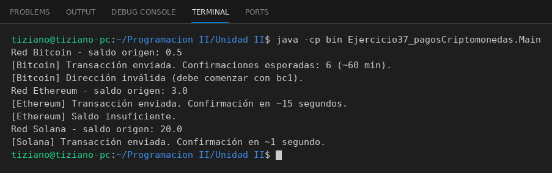

# RedBlockchain

Programación II - Unidad 2 - Ejercicio 37

## Consigna
Transferir valor entre wallets de distintas redes blockchain detrás de una interfaz común.

## Lógica
- Interfaz `RedBlockchain` con `verificarSaldo(wallet)` y `ejecutarTransaccion(origen, destino, monto)`.
- `RedBitcoin` (direcciones `bc1...`), `RedEthereum` (`0x` + 40 hexadecimales) y `RedSolana` (base58 de 32 a 44 caracteres) validan el formato de las direcciones y el saldo.
- `Main`: una variable de tipo interfaz que cambia de red, con transacciones exitosas y rechazadas.

## Ejecución

